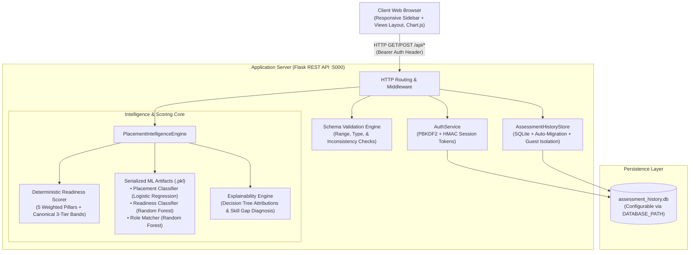

# System Architecture: LPU Placement Intelligence Platform

## 1. High-Level System Topology

The platform is designed as a decoupled, modular full-stack application separating presentation, API routing, business/readiness logic, machine learning inference, and persistence.



---

## 2. Decoupled Intelligence Subsystems

A critical architectural principle of the platform is the **strict separation** of empirical machine learning prediction from transparent pedagogical readiness scoring:

```
┌─────────────────────────────────────────────────────────────────────────────┐
│                             STUDENT ASSESSMENT                              │
└──────────────────────┬───────────────────────────────┬──────────────────────┘
                       │                               │
                       ▼                               ▼
       ┌───────────────────────────────┐ ┌───────────────────────────┐
       │   Supervised Placement ML     │ │  Transparent Readiness    │
       │   (Logistic Regression Pipeline)│ │  (Deterministic 5-Pillar) │
       │     Demo Model Estimate       │ │  Transparent Readiness    │
       │(Calibrated Logistic Regression│ │(Deterministic 5-Pillar    │
       │ on Synthetic Profiles)        │ │ Canonical 3-Tier Rubric)  │
       ├───────────────────────────────┤ ├───────────────────────────┤
       │ • Calibrated Posterior P(Y=1) │ │ • Technical Pillar  (30%) │
       │ • Whole % Display (e.g. 87%)  │ │ • Technical Pillar  (30%) │
       │ • Brier Score: 0.0516         │ │ • Aptitude Pillar   (25%) │
       │ • ROC-AUC: 0.9827             │ │ • Comm. Pillar      (20%) │
       │ • Binary Placement Status     │ │ • Projects Pillar   (15%) │
       │ • CTC Estimation (LPA)        │ │ • Internship Pillar (10%) │
       │ • Explicit Synthetic Notice   │ │ • Internship Pillar (10%) │
       └───────────────┬───────────────┘ └─────────────┬─────────────┘
                       │                               │
                       └───────────────┬───────────────┘
                                       ▼
                       ┌───────────────────────────────┐
                       │   Unified Student Dashboard   │
                       │   & Mentor Feedback Portal    │
                       │   Unified Improvement Plan    │
                       │   & Mentor Feedback Hub       │
                       └───────────────────────────────┘
```

### A. Deterministic 5-Pillar Readiness Scorer (`src/readiness_scorer.py`)
- **Mathematical Formulation**:
  $$S_{\text{readiness}} = \sum_{k=1}^5 w_k \cdot C_k$$
  Where:
  - Technical Pillar ($w_1 = 0.30$): Weighted blend of DSA Score ($40\%$), Coding Platform Rating ($30\%$), and Web/Cloud + System Design ($30\%$).
  - Aptitude Pillar ($w_2 = 0.25$): Quantitative Aptitude ($40\%$), Logical Reasoning ($35\%$), Verbal Ability ($25\%$).
  - Communication Pillar ($w_3 = 0.20$): Mock Interview ($45\%$), Group Discussion ($35\%$), Spoken English ($20\%$).
  - Projects Pillar ($w_4 = 0.15$): Scaled projects count ($\min(N, 4)$ cap) and GitHub code commit quality.
  - Internships Pillar ($w_5 = 0.10$): Internship count ($\min(N, 3)$ cap) and duration ($\min(M, 6)$ months cap).
- **Anti-Gaming Caps**: Maximum limits are enforced on project counts, certifications, and internship duration to prevent score manipulation through inflated volume.
- **Readiness Bands**:
- **Canonical 3-Tier Readiness Categories**:
  - **Needs attention**: $S < 40.0$
  - **Developing**: $40.0 \le S < 70.0$
  - **Strong preparation**: $70.0 \le S \le 100.0$
  - Backward compatibility: maps legacy 4-tier outputs (Foundation $\rightarrow$ Needs attention, Developing $\rightarrow$ Developing, Placement Ready & Advanced $\rightarrow$ Strong preparation).

### B. Supervised Placement Model (`src/ml_engine.py` & `models/`)
- Preprocessing via `ColumnTransformer`: Continuous features normalized with `StandardScaler`; academic department encoded with `OneHotEncoder(handle_unknown='ignore')`.
- Inference pipeline outputs calibrated placement probability $P(\text{Placement}=1)$ alongside estimated compensation package (CTC in LPA).
- Inference pipeline outputs whole-percentage **Demo Model Estimate** with accompanying synthetic profile notice.

### C. Skill-Gap Diagnosis Engine
- Formula: $\text{Gap} = \text{student score} - \text{role benchmark}$
- Thresholds with $\pm 3.0$ pt benchmark tolerance:
  - $\Delta < -15.0$: **Critical gap**
  - $-15.0 \le \Delta < -3.0$: **Below benchmark**
  - $-3.0 \le \Delta < 0.0$: **Within benchmark tolerance**
  - $0.0 \le \Delta \le 8.0$: **Meets benchmark**
  - $\Delta > 8.0$: **Above benchmark**
- Guarantees that negative gaps are never marked as "On Target".

---

## 3. Database Schema & Persistence

Stored in SQLite (`data/assessment_history.db`) with an auto-migration layer:
Stored in SQLite (`data/assessment_history.db`, configurable via `DATABASE_PATH` env var for isolated testing) with an auto-migration layer:

### A. `assessment_history` Table
| Column Name | SQL Type | Description |
| :--- | :--- | :--- |
| `id` | INTEGER PRIMARY KEY | Unique assessment sequential ID |
| `student_id` | TEXT | Student roll number or registration ID |
| `timestamp` | TEXT | ISO timestamp of submission |
| `student_id` | TEXT | Student roll number or registration ID |
| `owner_username` | TEXT | Account username that created the assessment |
| `branch` | TEXT | Academic department |
| `target_role` | TEXT | Target placement role |
| `cgpa` | REAL | Cumulative Grade Point Average |
| `active_backlogs` | INTEGER | Active backlogs at time of assessment |
| `readiness_tier` | TEXT | ML-predicted tier (Foundation / Developing / Ready / Advanced) |
| `readiness_tier` | TEXT | Canonical category (Needs attention / Developing / Strong preparation) |
| `readiness_score` | REAL | Deterministic 5-pillar score ($0.0 - 100.0$) |
| `readiness_band` | TEXT | Deterministic band (Needs attention / Developing / Strong preparation) |
| `readiness_band` | TEXT | Deterministic band |
| `readiness_category` | TEXT | Canonical 3-tier readiness category |
| `placement_pred` | INTEGER | Supervised prediction ($0$ = Not Placed, $1$ = Placed) |
| `placement_prob` | REAL | Calibrated placement probability ($0.0 - 100.0\%$) |
| `simulated_expected_ctc_lpa`| REAL | Estimated CTC package in LPA |
| `raw_input_json` | TEXT | Complete serialized input JSON |
| `full_result_json` | TEXT | Complete serialized evaluation output JSON |
| `scoring_version` | TEXT | Readiness scoring algorithm version |
| `placement_prob` | REAL | Internal float placement estimate ($0.0 - 100.0\%$) |
| `is_demo` | INTEGER | Flag ($1$ = Demo archetype, $0$ = Private student record) |
| `scoring_version` | TEXT | Readiness scoring algorithm version (`2.2.0_3tier`) |
| `model_version` | TEXT | ML artifact pipeline version (`2.1.0`) |

### B. `users` Table
| Column Name | SQL Type | Description |
| :--- | :--- | :--- |
| `id` | INTEGER PRIMARY KEY | User ID |
| `username` | TEXT UNIQUE | Login username |
| `password_hash` | TEXT | PBKDF2-HMAC-SHA256 hash |
| `salt` | TEXT | 16-byte random cryptographic salt |
| `role` | TEXT | User role (`student`, `mentor`, `admin`) |
| `full_name` | TEXT | Display name |
| `email` | TEXT | Contact email |
| `student_reference_id` | TEXT | Associated student roll number |
| `created_at` | TEXT | Account creation timestamp |

### C. `mentor_assignments` Table
| Column Name | SQL Type | Description |
| :--- | :--- | :--- |
| `id` | INTEGER PRIMARY KEY | Assignment record ID |
| `mentor_username` | TEXT | Username of assigned mentor |
| `student_id` | TEXT | Assigned student roll number |
| `assigned_at` | TEXT | Assignment timestamp |
### C. `mentor_assignments` & `mentor_feedback` Tables
Support faculty mentor student assignment rosters and actionable qualitative counseling feedback notes.

### D. `mentor_feedback` Table
| Column Name | SQL Type | Description |
| :--- | :--- | :--- |
| `id` | INTEGER PRIMARY KEY | Feedback entry ID |
| `mentor_username` | TEXT | Submitting mentor username |
| `assessment_id` | INTEGER | Assessment record evaluated |
| `student_id` | TEXT | Evaluated student ID |
| `feedback_notes` | TEXT | Actionable qualitative coaching guidance |
| `recommended_focus` | TEXT | High-priority preparation area |
| `created_at` | TEXT | Submission timestamp |

---

## 4. Authentication & Role-Based Access Control (RBAC)
## 4. Frontend Architecture: Responsive Sidebar & 7 Views

1. **Password Hashing**: PBKDF2 with HMAC-SHA256, a 16-byte cryptographically random salt per user, and 100,000 iterations.
2. **Session Security**: Stateless HMAC-SHA256 signed session tokens containing user identity, role, and expiry timestamp.
3. **Role Authorization**:
   - `student`: Can view and submit self-assessments; can only access their own assessment reports and historical records.
   - `mentor`: Can access assigned students' rosters, review student assessment reports, and submit feedback.
   - `admin`: Can view institutional cohort analytics, batch upload cohorts, and manage user assignments.
   - `guest`: Can run interactive demo simulations using preset profiles without persistence.

---

## 5. Local Explainability (XAI) Architecture

Local feature attribution identifies the top catalysts and gaps for an individual student:

1. **Attribution Metric**:
   $$A_j = w_j \cdot \frac{x_j - \mu_j}{\sigma_j}$$
   Where $w_j$ is the global feature importance from the ensemble, $x_j$ is the student's value, and $\mu_j, \sigma_j$ are the feature mean and standard deviation from the training cohort.
2. **Positive Catalysts**: Features where $A_j > 0$, sorted by descending magnitude.
3. **Preparation Gaps**: Features where $A_j < 0$, identifying highest-leverage areas for immediate student improvement.
4. **Actionable Recommendations**: Template-based pedagogical guidance linked directly to detected preparation gaps (e.g. recommending 100 additional DSA questions, mock interview clinics, or clearing backlogs).

The user interface uses a responsive layout separating navigation from content:
- **Desktop Sidebar Navigation** (250px, fixed, glassmorphism) with accessible mobile off-canvas drawer.
- **Top Bar Header** with page title, "Academic Prototype" badge, session profile chip, and theme toggle.
- **7 Concise Views**:
  1. `view-overview`: Hero, concept separation card, 1-click synthetic archetypes.
  2. `view-assessment`: 5-step wizard form with range sliders and real-time numeric badges.
  3. `view-plan`: Primary KPI summary, 5-pillar rubric bars, tree path attribution, 7-pillar radar, skill-gap analysis, and 90-day action roadmap.
  4. `view-history`: Longitudinal assessment progress tracking with live search and category filters.
  5. `view-mentor`: Faculty mentor hub, assigned student roster with whole-percentage demo model estimates, and counseling feedback submission.
  6. `view-cohorts`: TPO batch CSV processor with validation error reporting and cohort analytics.
  7. `view-methodology`: ML classifier benchmarks, regression tables, descending feature importances, and model governance notes.
