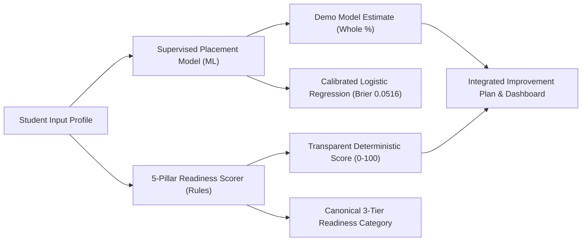

# Model Card: LPU Placement Intelligence & Student Readiness Models

## 1. Model Details

- **Model Version**: 2.2.0
- **Model Type**: Supervised Binary Placement Classifier, Multi-Class Readiness Tier Classifier, and Continuous CTC Regressor
- **Architecture**: Scikit-Learn `Pipeline` with `ColumnTransformer` (StandardScaler for continuous features, OneHotEncoder for academic department)
- **Serialization**: Python `joblib` / `pickle` stored in `models/` directory:
  - `placement_classifier.pkl` (Champion Binary Placement Classifier: Calibrated Logistic Regression)
  - `readiness_classifier.pkl` (Champion Multi-Class Readiness Classifier: Random Forest)
  - `ctc_regressor.pkl` (Gradient Boosting Regressor — Experimental Simulation)
  - `prob_regressor.pkl` (Gradient Boosting Regressor — Experimental Simulation)
  - `role_classifier.pkl` (Random Forest Role Matcher)
  - `preprocessor.pkl` (Fitted ColumnTransformer)
  - `model_metrics.json` (Serialized benchmark and evaluation metadata)

---

## 2. Intended Use & Non-Goals

### Intended Use Cases
- **Student Diagnostic Self-Assessment**: Empowers students to evaluate their pre-placement preparation profile, understand skill gaps, and explore role alignment.
- **Academic Mentorship**: Provides faculty mentors and training advisors with a standardized baseline to review student progress and provide actionable feedback.
- **Preparatory Prioritization**: Identifies high-impact preparation domains (e.g., clearing active backlogs, solving verified DSA problems, practicing mock interviews).

### Non-Goals & Prohibited Uses
> [!CAUTION]
> - **Automated Placement Gatekeeping**: This system must **never** be used to automatically disqualify, reject, or debar students from campus recruitment drives or company registration.
> - **Definitive Outcome Guarantee**: A high model estimate does not guarantee an employment offer, nor does a low estimate preclude success.
> - **Official Institutional Stamping**: As an academic demonstration prototype evaluated on synthetic rubric benchmarks, outputs must not be represented as official institutional predictions from Lovely Professional University.

---

## 3. Honest Terminology & Metric Definitions

To prevent confusion between statistical estimates, rubric scores, and data completeness, the platform enforces three distinct metrics:

1. **Demo Model Estimate** (Whole percentage integer display, e.g. `87%`):
   - Supervised model classification estimate trained on synthetic historical placement profiles.
   - Accompanying disclosure: *"Generated by a model trained on synthetic profiles. Not validated for real student placement outcomes."*
   - Not called confidence, certainty, or real-world placement probability.
2. **Student Readiness Assessment** (0 - 100 score):
   - Deterministic 5-pillar university rubric calculated via transparent weights (Technical 30%, Aptitude 25%, Communication 20%, Projects 15%, Internships 10%).
   - Mapped into canonical 3-tier readiness categories:
     - **Needs attention**: Score $< 40$
     - **Developing**: $40 \le \text{Score} < 70$
     - **Strong preparation**: $70 \le \text{Score} \le 100$
3. **Input Completeness** (Percentage, e.g. `100%`):
   - Explicit tooltip & note: *"Percentage of required assessment fields supplied. This is not model confidence or placement likelihood."*
4. **Secondary Experimental Projections**:
   - Simulated expected CTC and continuous probability regression outputs are moved to a secondary experimental research drawer and explicitly caveated as unvalidated synthetic regressions.

---

## 4. Training & Evaluation Methodology

- **Data Source**: `data/lpu_placement_dataset.csv` (2,000 synthetic student profiles).
- **Split Strategy**: 80% Training ($N=1,600$), 20% Holdout Test ($N=400$), stratified by target class.
- **Cross-Validation**: 3-Fold Stratified Cross-Validation on the training partition ($N=1,600$) to evaluate model stability.
- **Leakage Prevention**: All imputation, scaling, and categorical encoders are strictly fit on the training partition and transformed on test/inference data.
- **Fairness Guarantee**: Demographic attributes (`gender`) are completely excluded from the dataset, schemas, and models.

---

## 5. Benchmark Results & Model Selection

### A. Supervised Binary Placement Prediction ($y \in \{0, 1\}$)

| Model Candidate | Test Accuracy | Precision | Recall | F1 Score | ROC-AUC | PR-AUC | Brier Score | Status |
| :--- | :--- | :--- | :--- | :--- | :--- | :--- | :--- | :--- |
| **Dummy Classifier (Majority)** | 53.25% | 53.25% | 100.0% | 0.6949 | 0.5345 | 0.7662 | 0.2493 | Baseline |
| **Logistic Regression (Champion)** | **92.50%** | **93.36%** | **92.49%** | **0.9292** | **0.9827** | **0.9880** | **0.0516** | **Selected Champion** |
| **Decision Tree** | 86.75% | 87.04% | 88.26% | 0.8765 | 0.9462 | 0.3893 | 0.0896 | Candidate |
| **Random Forest Classifier** | 90.00% | 89.86% | 91.55% | 0.9070 | 0.9690 | 0.9780 | 0.0755 | Candidate |

#### Selection Rationale:
Logistic Regression achieved the lowest Brier Score ($0.0516$), highest ROC-AUC ($0.9827$), and highest F1 ($0.9292$). Because binary placement requires reliable, well-calibrated posterior probabilities $P(\text{Placement}=1)$, Logistic Regression provides superior calibration and transparent odds-ratio interpretability compared to tree ensembles.

---

### B. Multi-Class Student Readiness Tier Prediction

| Model Candidate | Test Accuracy | Macro F1 | Weighted F1 | 3-Fold CV Accuracy | Status |
| :--- | :--- | :--- | :--- | :--- | :--- |
| **Random Forest Classifier** | **84.75%** | **0.8423** | **0.8475** | **84.00% ± 1.24%** | **Selected Champion** |
| **Multi-Class Logistic Regression** | 81.50% | 0.6682 | 0.8022 | 80.44% ± 0.92% | Candidate |
| **Decision Tree Classifier** | 80.75% | 0.8147 | 0.8075 | 78.25% ± 2.07% | Candidate |

---

## 6. Global Feature Importance Audit: Investigation of `active_backlogs`

Feature importances derived from the Random Forest ensemble are sorted in strictly descending order:

| Rank | Feature | Relative Importance (%) | Category | Practical Meaning & Audit Notes |
| :---: | :--- | :---: | :--- | :--- |
| 1 | `active_backlogs` | **12.19%** | Academic Risk | Immediate gatekeeping filter for recruitment drive eligibility |
| 2 | `dsa_problems_solved` | **7.89%** | Technical Competency | Volume of algorithmic practice verified on online judges |
| 3 | `coding_rating` | **7.13%** | Technical Competency | Real-time contest performance under time constraints |
| 4 | `mock_interview_score` | **6.85%** | Communication / Soft Skills | Panel evaluation of behavioral and technical communication |
| 5 | `dsa_score` | **6.74%** | Technical Competency | Core foundational knowledge of data structures |
| 6 | `logical_reasoning` | **6.58%** | Cognitive Aptitude | General problem solving and analytical thinking |
| 7 | `quantitative_aptitude` | **6.26%** | Cognitive Aptitude | Mathematical proficiency for online screening rounds |
| 8 | `cgpa` | **5.99%** | Academic Consistency | Cumulative academic standing across semesters |
| 9 | `system_design_score` | **5.03%** | Advanced Technical | Architecture, API design, and modularity skills |
| 10 | `web_cloud_score` | **5.01%** | Applied Technical | Practical development experience with modern stacks |
| 11 | `gd_score` | **4.82%** | Communication | Group discussion articulation and teamwork dynamics |
| 12 | `verbal_ability` | **4.53%** | Cognitive Aptitude | English vocabulary, comprehension, and grammar ability |

### Root-Cause Analysis for `active_backlogs` High Prominence:
1. **Label Generation Rules (`src/data_generator.py`)**:
   - Candidates carrying active backlogs receive an aggressive clearance penalty (`backlog_penalty = active_backlogs * 0.15 + history_backlogs * 0.03`).
   - If a student carries $\ge 2$ active backlogs, their clearance likelihood is capped at $45.0\%$, barring them from the upper tiers regardless of high DSA or project scores.
2. **Binary Placement Definition (`src/train_models.py`)**:
   - `placed_binary = ((df["placement_probability"] >= 50.0) & (df["active_backlogs"] <= 1)).astype(int)`
   - Candidates with $> 1$ backlog are deterministically marked as unplaced.
3. **Decision Tree Split Mechanics**:
   - Because `active_backlogs` acts as a hard filter, decision tree algorithms identify it as an early, high-purity split near the root nodes to achieve high initial information gain (Gini impurity reduction).
   - This reflects the reality of campus drive eligibility criteria rather than model artifact manipulation or chart construction errors.

---

## 7. Two-System Decoupled Architecture

1. **Supervised Placement Model**:
   - Answers: *"Given historical training patterns, what is the empirical likelihood of clearing campus placement?"*
2. **Transparent Readiness Scorer**:
   - Answers: *"According to the institutional career rubric, what is the student's mastery across 5 key pillars?"*
   - Deterministic, fully transparent, bounded, and resistant to algorithmic distribution shifts.

---

## 8. Limitations & Ethical Notice

- **Synthetic Rubric Baseline**: Model weights reflect the synthetic correlation rubric defined in `data/lpu_placement_dataset.csv`. Predictions will shift when re-trained on actual institutional datasets.
- **Gini Impurity Bias**: Impurity-based feature importances can favor continuous or multi-valued features over low-cardinality features.
- **Distribution Shift**: If academic syllabi or industry recruitment patterns change (e.g. shift toward Generative AI competencies), models must be re-trained with updated telemetry.
